<div align="center">

# Belar Inmobiliaria

**Plataforma inmobiliaria full stack con diseño premium, cuentas para clientes y propietarios, revisión de publicaciones y valoración de precios con un modelo de regresión.**


<br>


</div>

---

## Contenido

- [Qué es](#qué-es)
- [Capturas](#capturas)
- [Funcionalidades](#funcionalidades)
- [Cuentas y roles](#cuentas-y-roles)
- [Flujo de revisión de propiedades](#flujo-de-revisión-de-propiedades)
- [Valoración de precios](#valoración-de-precios)
- [Seguridad](#seguridad)
- [Arquitectura](#arquitectura)
- [Instalación y ejecución](#instalación-y-ejecución)
- [Configuración](#configuración)
- [API](#api)
- [Pruebas](#pruebas)
- [Decisiones y límites honestos](#decisiones-y-límites-honestos)
- [Hoja de ruta](#hoja-de-ruta)
- [Autor y licencia](#autor-y-licencia)

---

## Qué es

Belar Inmobiliaria es un sitio web para publicar, buscar y gestionar propiedades en **Cartagena, Bogotá, Medellín y Barranquilla**. Tiene tres tipos de usuarios (cliente, propietario y administrador), cada uno con su propio panel, y un diseño oscuro con acentos dorados pensado para una inmobiliaria de gama alta.

Es un **proyecto de portafolio**: usa datos de demostración y no representa a una empresa real. Está construido sin frameworks de frontend: HTML, CSS y JavaScript puro servidos por Spring Boot, lo que lo hace liviano y fácil de desplegar.

> **Lo que más lo distingue:** los propietarios publican sus propiedades, el equipo las revisa antes de que salgan al público, y una estimación de precio con un modelo de regresión (Weka) ayuda a decidir cuánto pedir, mostrando siempre su margen de error real.

---

## Capturas

### Sitio público

| | |
|---|---|
| 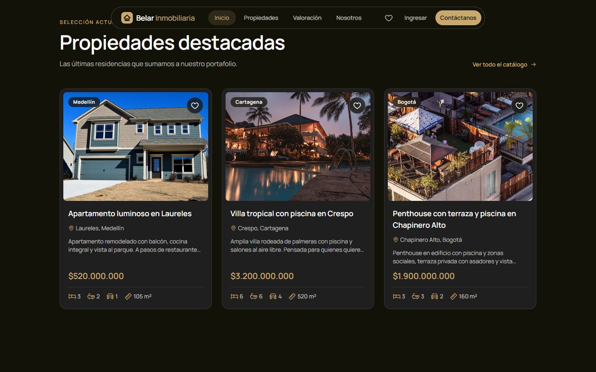<br><sub>Propiedades destacadas con la frase que se enciende al hacer scroll</sub> | <br><sub>Herramientas reales: favoritos, mapa, calculadora y valoración</sub> |
| 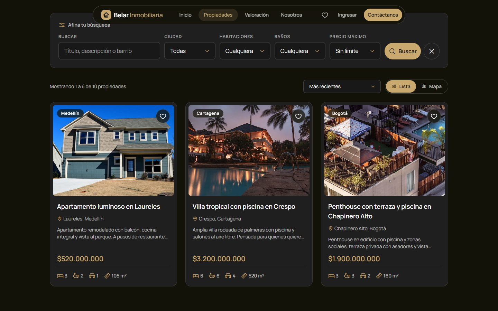<br><sub>Catálogo con filtros, orden y paginación</sub> | 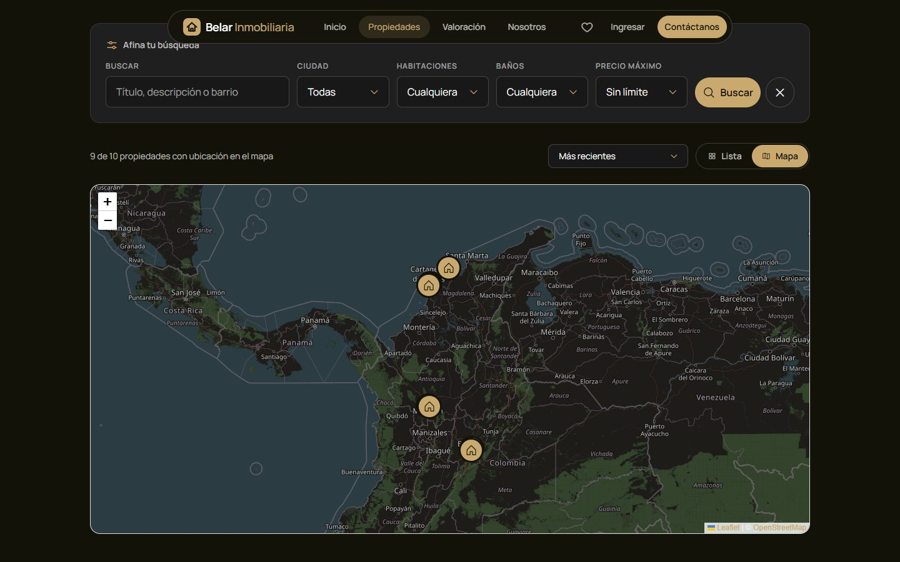<br><sub>Vista de mapa con un marcador por propiedad</sub> |
| 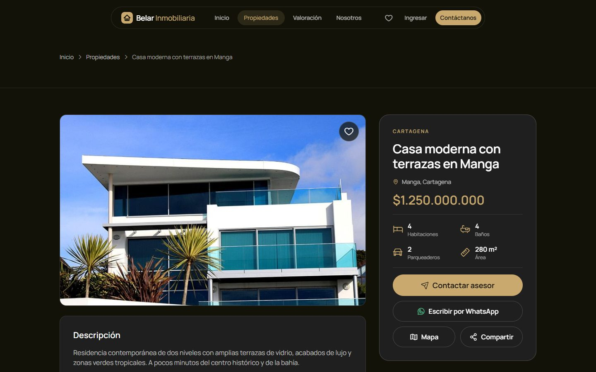<br><sub>Ficha con galería, WhatsApp y compartir</sub> | 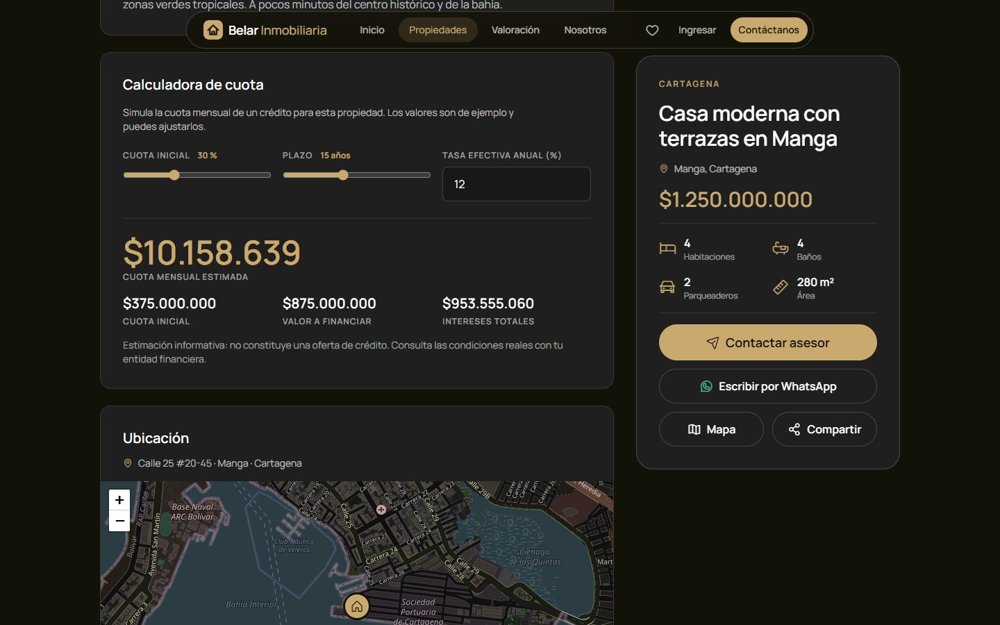<br><sub>Calculadora de cuota hipotecaria y mapa oscuro</sub> |
| <br><sub>Valoración con rango y margen de error</sub> | 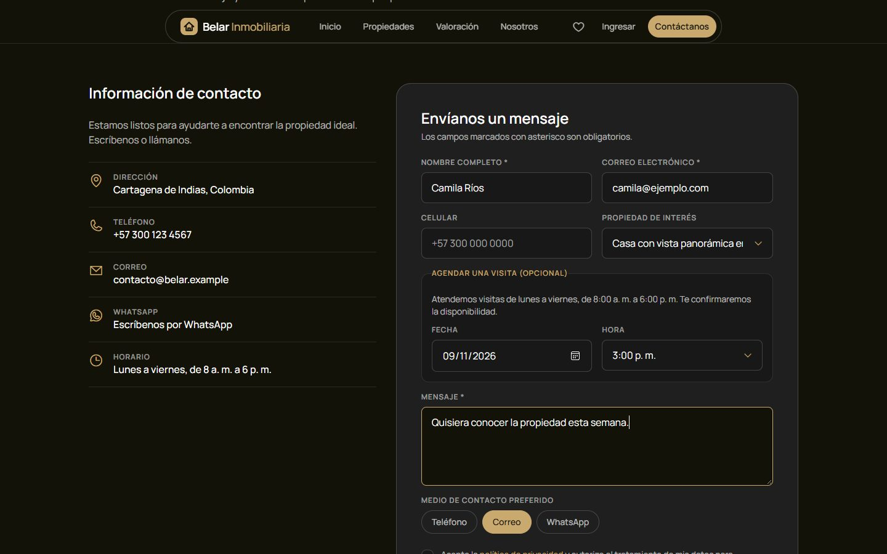<br><sub>Contacto con agenda de visita (lunes a viernes)</sub> |

### Cuentas

| | |
|---|---|
| 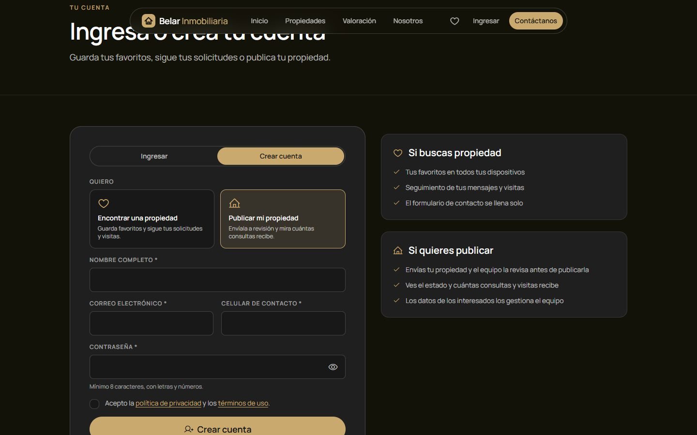<br><sub>Ingresar o crear cuenta, eligiendo buscar o publicar</sub> | <br><sub>Cliente: favoritos sincronizados entre dispositivos</sub> |
| 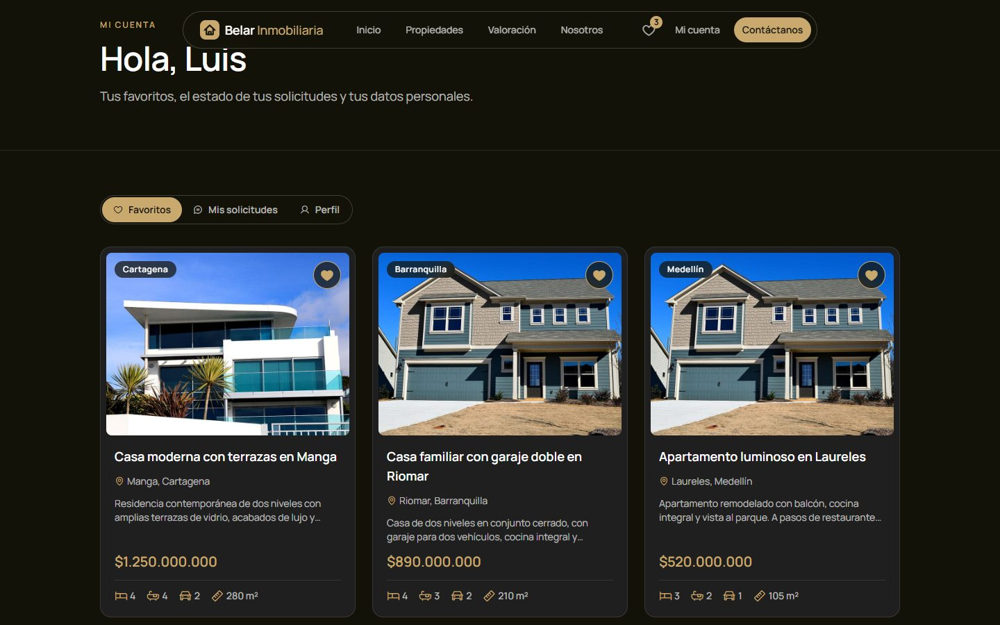<br><sub>Cliente: estado de sus mensajes y visitas</sub> | 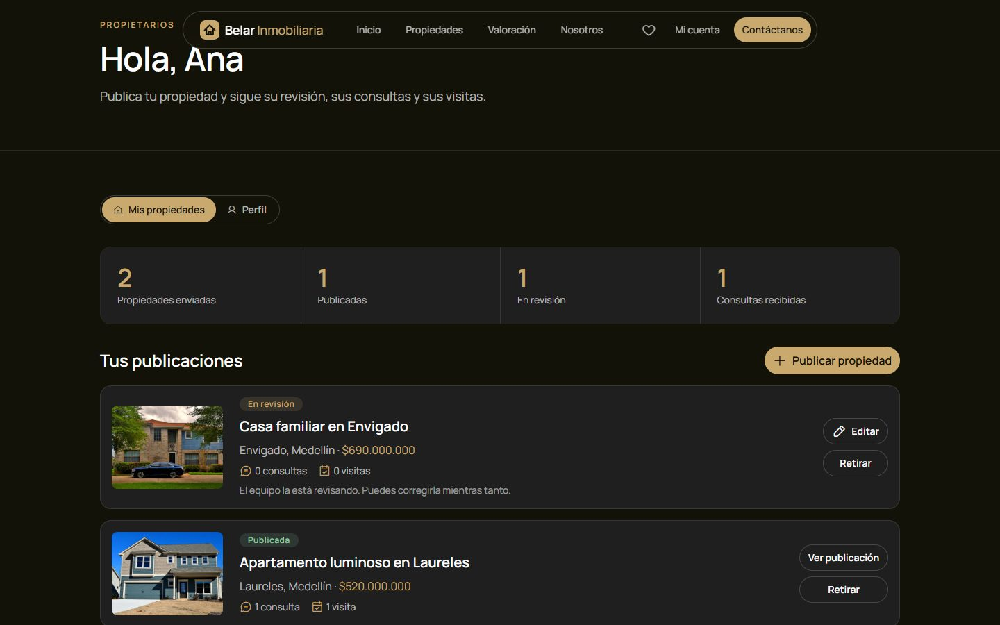<br><sub>Propietario: estados, consultas y visitas por propiedad</sub> |
| 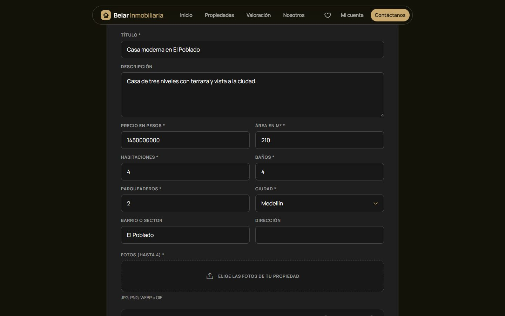<br><sub>Propietario: formulario con vista previa y estimación de precio</sub> | |

### Panel de administración

| | |
|---|---|
| 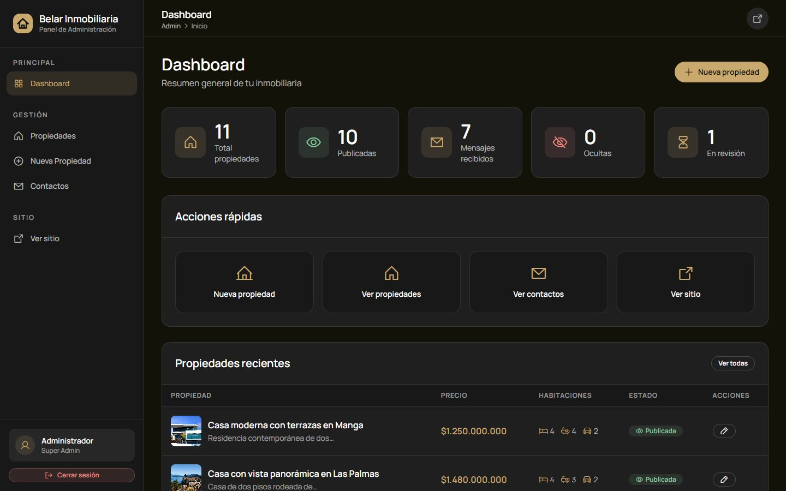<br><sub>Dashboard con métricas y propiedades en revisión</sub> | 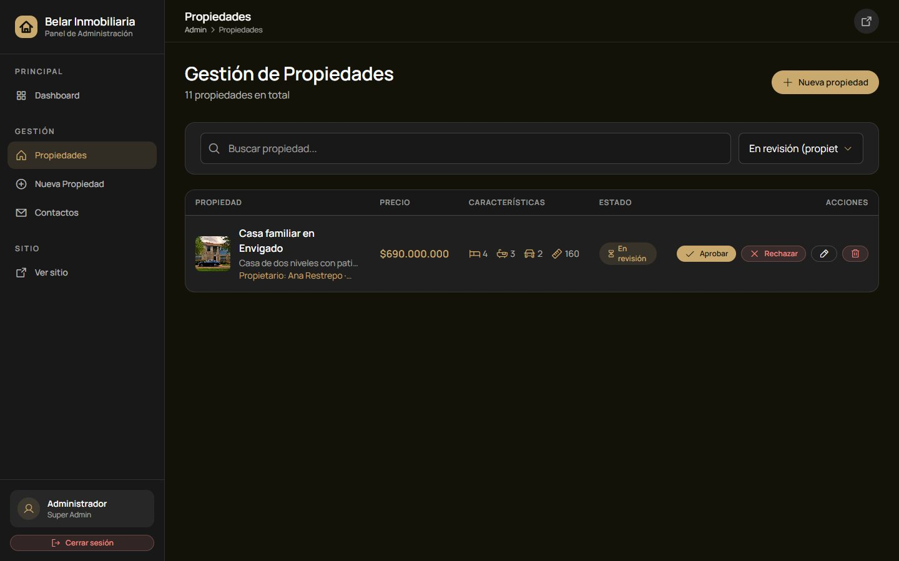<br><sub>Aprobar o rechazar lo que envían los propietarios</sub> |
| 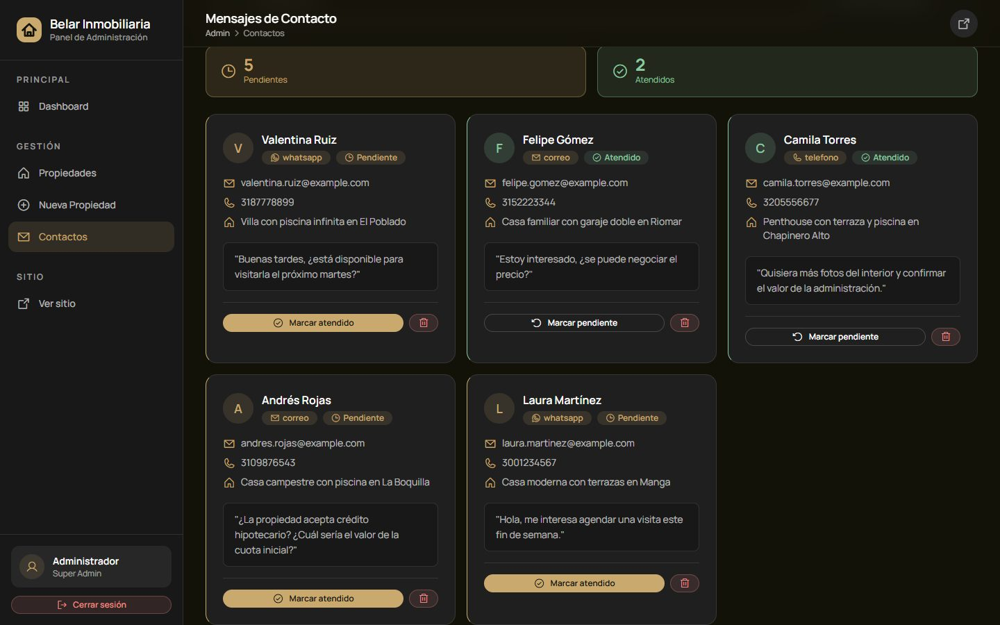<br><sub>CRM de mensajes con visitas solicitadas</sub> | |

### Móvil

<table>
  <tr>
    <td align="center">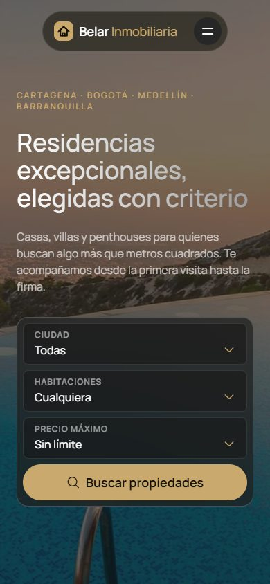<br><sub>Inicio</sub></td>
    <td align="center">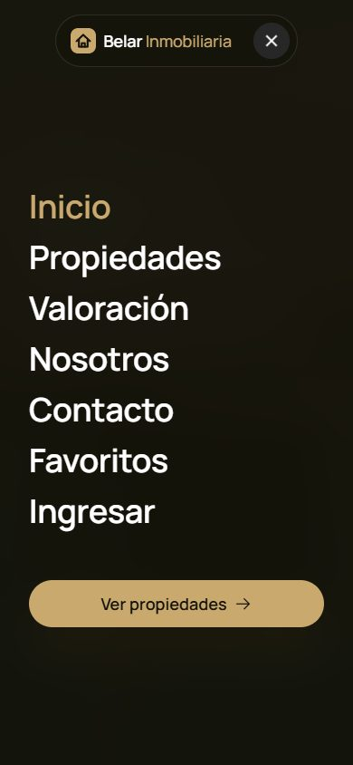<br><sub>Menú de altura completa</sub></td>
    <td align="center">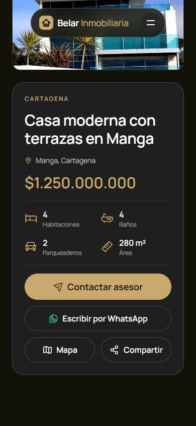<br><sub>Ficha de propiedad</sub></td>
  </tr>
</table>

---

## Funcionalidades

### Para quien busca propiedad
- **Catálogo** con filtros por ciudad, habitaciones, baños y precio máximo, chips de filtros activos, orden por precio o área y paginación. Los filtros se pueden precargar por URL (`/anuncio.html?ciudad=Cartagena&habitaciones=3`).
- **Vista de mapa** con un marcador por propiedad que respeta los filtros (Leaflet y OpenStreetMap, con estilo oscuro).
- **Ficha de propiedad** con galería, mapa, características, propiedades similares, botón de **compartir** y botón de **WhatsApp** con el mensaje y el enlace ya escritos.
- **Calculadora de cuota** hipotecaria (cuota fija) con cuota inicial, plazo y tasa ajustables.
- **Favoritos** con corazón en tarjetas y fichas. Funcionan sin registrarse y, si hay cuenta de cliente, se sincronizan entre dispositivos.
- **Agendar visita** desde el formulario de contacto: fecha entre mañana y 60 días, de lunes a viernes y en horas en punto de 8:00 a 17:00, validada en el navegador y en el servidor.
- **Valoración pública** de una propiedad con rango y margen de error.
- **Correos automáticos** de confirmación al cliente y de aviso a la inmobiliaria (opcionales: solo se envían si se configura un servidor de correo).

### Diseño y experiencia
- Sistema visual propio: negro cálido `#131209` y dorado champán `#C9A96E`, tipografía **Manrope** e íconos **Phosphor**.
- Scroll suave con inercia (Lenis), revelado de secciones con `IntersectionObserver`, parallax en el hero, frase que se enciende palabra por palabra y navegación flotante con menú móvil de altura completa.
- Respeta `prefers-reduced-motion`, contraste mínimo AA, enlace "Saltar al contenido", foco visible y atributos ARIA en pestañas, menús y avisos.
- Responsive de punta a punta: sin scroll horizontal desde 390 px.
- Páginas legales (política de privacidad y términos de uso, genéricas y basadas en la Ley 1581 de 2012) y una página 404 con la marca.

### Para el equipo (administrador)
- **Dashboard** con métricas y propiedades recientes.
- **Gestión de propiedades**: crear con imágenes y mapa para marcar la ubicación, editar, ocultar y eliminar.
- **Revisión** de lo que envían los propietarios: aprobar con un clic o rechazar con un motivo, viendo los datos de contacto del propietario.
- **CRM de mensajes**: estado pendiente o atendido, búsqueda, filtros, paginación y visitas solicitadas.
- Estimación de precio con el modelo de regresión al crear una propiedad.

---

## Cuentas y roles

Un solo formulario de ingreso lleva a cada persona a su panel según su rol.

| Rol | Cómo se obtiene | Qué puede hacer | Qué **no** puede hacer |
|---|---|---|---|
| **Cliente** | Registro público | Guardar favoritos sincronizados, ver el estado de sus mensajes y visitas, administrar su perfil y contraseña, y tener el formulario de contacto precargado | Acceder a las áreas de propietarios o del administrador |
| **Propietario** | Registro público (con celular de contacto) | Enviar propiedades a revisión, ver su estado, el motivo de un rechazo y cuántas **consultas y visitas** recibe cada una, corregir y reenviar, y retirarlas | Ver el nombre o el correo de las personas interesadas, publicar sin revisión o editar una propiedad ya publicada |
| **Administrador** | Se crea al arrancar la aplicación | Todo el panel: propiedades, revisión, mensajes y estimación de precio | — |

> Un rol de administrador **nunca** se puede crear desde el registro público.

---

## Flujo de revisión de propiedades

Las propiedades enviadas por propietarios nacen **en revisión** y solo llegan al catálogo público cuando el administrador las aprueba.

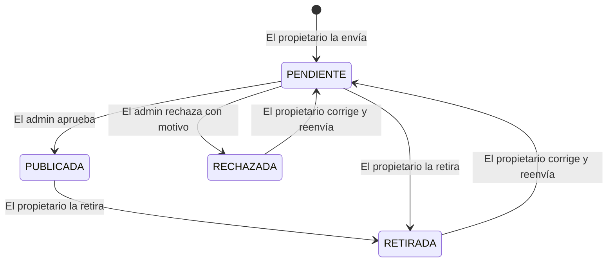

Solo lo que está `PUBLICADA` y visible aparece en el catálogo, en la ficha pública y permite agendar visitas.

---

## Valoración de precios

La estimación usa una **regresión lineal de Weka** entrenada con `propiedades_colombia.arff` (habitaciones, baños, parqueaderos, metros cuadrados y ciudad).

- Al arrancar, la aplicación calcula el **error absoluto medio (MAE)** sobre esos datos y el rango de áreas que cubren, y lo usa para mostrar un **rango** en vez de una cifra falsamente exacta.
- Si el área queda fuera de lo que conoce el modelo, lo advierte.
- La versión pública tiene un límite de 12 consultas por minuto y por IP.

> **Importante:** el conjunto de datos tiene 250 registros de ejemplo, generados para un curso de minería de datos. La estimación es una referencia estadística y no reemplaza el avalúo de un perito.

---

## Seguridad

| Medida | Detalle |
|---|---|
| Permisos por rol | `/api/cliente`, `/api/propietario`, `/api/cuenta` y `/api/**` (admin) separados. Verificado con una matriz de pruebas |
| Contraseñas | BCrypt, mínimo 8 caracteres con letra y número. El administrador inicial toma su contraseña de `ADMIN_PASSWORD` o se genera al azar, nunca hay una por defecto |
| Sesión | Cookie `HttpOnly` y `SameSite=Lax`; opción `Secure` para producción |
| Fuerza bruta y abuso | Límites por IP en login, registros, mensajes de contacto y valoración, y un máximo de 5 envíos de propiedades por día para cada propietario |
| Redirecciones | `origen` y `volver` del login solo aceptan rutas internas (sin redirección abierta) |
| XSS | Todo texto de usuarios se escapa antes de pintarse (`esc()`); verificado con un ataque real en catálogo, ficha y CRM |
| Subida de imágenes | Nombre con UUID, extensión y tipo validados, máximo 4 fotos y limpieza de archivos si la subida falla |
| Aislamiento | Un propietario solo ve y edita lo suyo; el servidor fija el dueño, el estado y la visibilidad (nunca el cuerpo de la petición) |
| Correos | Sin inyección de cabeceras con datos del usuario |
| Privacidad | El propietario nunca ve datos personales de los interesados |

---

## Arquitectura

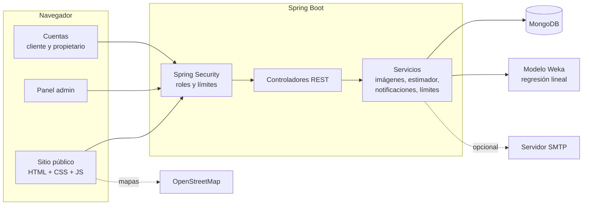

### Estructura

```
inmobiliaria/
├── src/main/java/com/example/inmobiliaria/
│   ├── config/        Seguridad, administrador inicial, datos de muestra, límite de login
│   ├── controller/    REST: propiedades, contacto, valoración, auth, cuenta, cliente, propietario
│   ├── model/         Propiedad, Contacto, Usuario
│   ├── repository/    Spring Data MongoDB
│   └── Service/       Imágenes, estimador de precio, notificaciones, límites, usuario actual
├── src/main/resources/
│   ├── modelo_precio.model, propiedades_colombia.arff   Modelo y datos de Weka
│   └── static/
│       ├── css/       premium.css, premium-pages.css (sitio) y admin.css (panel)
│       ├── js/        premium.js, app.js, anuncios.js, propiedad.js, cuenta.js, propietario.js...
│       ├── admin/     Panel de administración
│       └── *.html     Páginas públicas, de cuentas y legales
├── docs/screenshots/  Capturas de este README
└── tests/             Pruebas de navegador y de API
```

---

## Instalación y ejecución

### Requisitos

- **Java 17** o superior
- **MongoDB** en `localhost:27017` (o una URI propia con `MONGODB_URI`)
- Maven (se incluye el wrapper `mvnw`)

### Pasos

```bash
git clone https://github.com/BryanCTG/inmobiliaria.git
cd inmobiliaria

# Con datos de muestra (9 propiedades y 5 mensajes). Solo carga si la base está vacía
./mvnw spring-boot:run "-Dspring-boot.run.arguments=--app.seed=true"

# En Windows
mvnw.cmd spring-boot:run "-Dspring-boot.run.arguments=--app.seed=true"
```

Abre **http://localhost:8080**.

### Administrador

Al arrancar por primera vez se crea el usuario `admin`:

- Si defines `ADMIN_PASSWORD`, esa será su contraseña.
- Si no, se genera una contraseña aleatoria que se imprime **una sola vez** en la consola.

El panel está en `/admin/login.html` (también hay un enlace en el pie de página).

---

## Configuración

Todo se configura con variables de entorno; nada sensible vive en el repositorio.

| Variable | Para qué sirve | Por defecto |
|---|---|---|
| `MONGODB_URI` | Conexión a MongoDB | `mongodb://localhost:27017/bienesraices` |
| `ADMIN_PASSWORD` | Contraseña inicial del administrador | Aleatoria, se muestra una vez |
| `COOKIE_SECURE` | Marca la cookie de sesión como `Secure` (usar `true` con HTTPS) | `false` |
| `MAIL_HOST` | Servidor SMTP. **Sin esto no se envían correos** y todo lo demás funciona igual | vacío |
| `MAIL_PORT`, `MAIL_USER`, `MAIL_PASSWORD` | Datos del servidor SMTP | `587`, vacío, vacío |
| `MAIL_AUTH`, `MAIL_STARTTLS` | Opciones del servidor SMTP | `true`, `true` |
| `MAIL_FROM` | Remitente de los correos | `MAIL_USER` |
| `NOTIFY_ADMIN_EMAIL` | Dirección que recibe el aviso de cada mensaje | vacío |

El número de **WhatsApp** y los datos de contacto se cambian en un solo lugar: `src/main/resources/static/js/site-config.js`.

Los límites por IP (login, contacto) están en `application.properties`.

---

## API

<details>
<summary><b>Pública</b></summary>

| Método | Ruta | Descripción |
|---|---|---|
| `GET` | `/api/propiedades/visibles` | Propiedades publicadas |
| `GET` | `/api/propiedades/{id}` | Detalle de una propiedad publicada |
| `POST` | `/api/contacto` | Enviar un mensaje, con visita opcional |
| `POST` | `/api/valoracion` | Estimación de precio con rango |
| `GET` | `/api/valoracion/info` | Ciudades y datos del modelo |
| `POST` | `/api/auth/registro` | Crear cuenta de cliente o propietario |
| `GET` | `/api/auth/yo` | Quién está conectado |

</details>

<details>
<summary><b>Cuentas (cliente y propietario)</b></summary>

| Método | Ruta | Rol | Descripción |
|---|---|---|---|
| `GET` `PUT` | `/api/cuenta/perfil` | Cliente, propietario | Ver y actualizar el perfil |
| `PUT` | `/api/cuenta/password` | Cliente, propietario | Cambiar la contraseña |
| `GET` `PUT` | `/api/cliente/favoritos` | Cliente | Favoritos de la cuenta |
| `GET` | `/api/cliente/solicitudes` | Cliente | Mensajes y visitas con su estado |
| `GET` | `/api/propietario/propiedades` | Propietario | Sus propiedades con consultas y visitas |
| `GET` | `/api/propietario/propiedades/{id}` | Propietario | Una de sus propiedades |
| `POST` | `/api/propietario/propiedades` | Propietario | Enviar una propiedad a revisión (multipart) |
| `PUT` | `/api/propietario/propiedades/{id}` | Propietario | Corregir y reenviar (multipart) |
| `POST` | `/api/propietario/propiedades/{id}/retirar` | Propietario | Retirar |

</details>

<details>
<summary><b>Administrador</b></summary>

| Método | Ruta | Descripción |
|---|---|---|
| `GET` | `/api/propiedades` | Todas, con estado y datos del propietario |
| `POST` `PUT` `DELETE` | `/api/propiedades[/{id}]` | Crear, editar y eliminar |
| `PATCH` | `/api/propiedades/{id}/visibilidad` | Publicar u ocultar |
| `PATCH` | `/api/propiedades/{id}/estado` | Aprobar o rechazar (con motivo) |
| `GET` | `/api/contacto` | Mensajes recibidos |
| `PATCH` | `/api/contacto/{id}/atendido` | Marcar atendido o pendiente |
| `DELETE` | `/api/contacto/{id}` | Eliminar un mensaje |
| `POST` | `/api/prediccion/precio` | Estimación para el formulario de crear |

</details>

Los errores de la API responden con `{ "mensaje": "..." }`, para mostrar un texto claro al usuario.

---

## Pruebas

El proyecto incluye **253 comprobaciones automáticas** en la carpeta [`tests/`](tests/): pruebas de extremo a extremo con un navegador real (Edge o Chrome controlado con `puppeteer-core`) y pruebas directas a la API.

| Archivo | Comprobaciones | Qué cubre |
|---|---:|---|
| `publico.js` | 33 | Búsqueda, filtros, contacto, XSS, movimiento reducido, móvil |
| `admin.js` | 27 | Login, CRUD de propiedades, CRM, menú móvil |
| `funciones.js` | 32 | Favoritos, orden, mapa, WhatsApp, calculadora, similares |
| `valoracion-visitas.js` | 24 | Valoración, agendar visita, encabezado responsive |
| `cuentas-ui.js` | 56 | Registro, sesión, favoritos entre dispositivos, flujo del propietario y revisión |
| `cuentas-api.py` | 81 | Matriz de permisos entre roles, abusos y límites |

Instrucciones y advertencias en [`tests/README.md`](tests/README.md).

---

## Decisiones y límites honestos

- **Datos de demostración.** Las propiedades, los mensajes, el correo `contacto@belar.example` y el teléfono son de ejemplo. Los textos legales son genéricos y deben revisarse con un abogado antes de un uso comercial.
- **Modelo de precios.** Se entrenó con 250 registros de ejemplo; por eso se muestra un rango con su margen de error y una advertencia cuando el área queda fuera de lo conocido.
- **Límites en memoria.** Los límites por IP viven en la memoria de la aplicación: sirven con una sola instancia. Con varias habría que moverlos a un almacén compartido como Redis. Detrás de un proxy hay que activar el reenvío de la IP real.
- **CSRF.** Está desactivado y se mitiga con cookie de sesión `SameSite=Lax` y `HttpOnly`. Antes de producción conviene activarlo.
- **Correos.** Solo se envían si se configura `MAIL_HOST`. El envío se probó con un servidor SMTP local de prueba, no con un proveedor real.
- **Mapas.** Usan los mosaicos públicos de OpenStreetMap, aptos para un proyecto de portafolio pero no para tráfico alto.

---

## Hoja de ruta

- [ ] Migrar la base a PostgreSQL (Supabase) y las imágenes a almacenamiento en la nube
- [ ] Desplegar con HTTPS (`COOKIE_SECURE=true`) y proxy con IP real
- [ ] Activar protección CSRF con token
- [ ] Recuperación de contraseña por correo
- [ ] Notificar al propietario cuando su propiedad sea aprobada o rechazada
- [ ] Optimizar las imágenes al subirlas (WebP y tamaños responsive)
- [ ] Reemplazar los datos de ejemplo del modelo por datos reales de mercado

---

## Autor y licencia

**Bryan Beltrán** · Cartagena, Colombia
[GitHub @BryanCTG](https://github.com/BryanCTG)

Proyecto con fines educativos y de portafolio. Las fotografías de demostración provienen de la plantilla original del proyecto y deben reemplazarse por material propio o con licencia antes de un uso comercial.

<div align="center">
<sub>Hecho con Spring Boot, MongoDB y mucho cuidado por el detalle.</sub>
</div>
